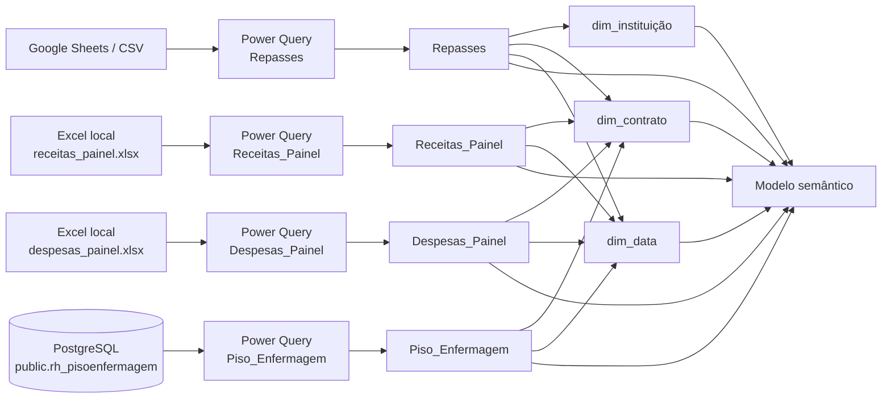
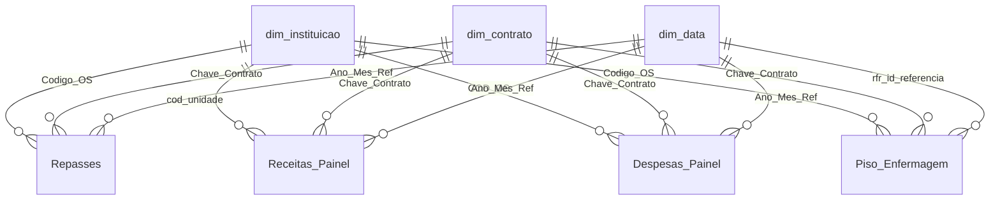

# PBI - Piso de Enfermagem

Repositório técnico do painel **Piso_Enfermagem**.

Este repositório documenta o sistema **como ele está implementado hoje (AS-IS)**, com foco em engenharia de dados: origem, ingestão, transformação, chaves, granularidade, relacionamentos, qualidade, atualização e pontos de falha.

## 1. Resumo executivo

A documentação detalhada das conexões e do fluxo de ingestão está em [engenharia_dados/](./engenharia_dados/).

O Power BI está exercendo quatro responsabilidades ao mesmo tempo:

1. **ingestão** de Google Sheets, Excel e PostgreSQL;
2. **transformação** em Power Query;
3. **normalização/dados mestres** de Organização Social e contrato em DAX;
4. **camada semântica** consumida pelo relatório.

Isso funciona, mas aumenta o acoplamento do relatório às fontes e faz com que regras estruturais de dados fiquem dentro do modelo semântico.

### Modelo Relacional

## 2. Modelo de dados

O núcleo do modelo é composto por quatro conjuntos transacionais e três dimensões compartilhadas.

| Objeto | Papel | Origem | Grain observado | Chaves de integração |
|---|---|---|---|---|
| `Repasses` | fato de repasses | Google Sheets CSV | registro de repasse | `Codigo_OS`, `Chave_Contrato`, `Ano_Mes_Ref` |
| `Receitas_Painel` | fato de receitas | Excel | item/registro de receita | `cod_unidade`, `Chave_Contrato`, `Ano_Mes_Ref` |
| `Despesas_Painel` | fato de despesas | Excel | documento/registro de despesa | `COD_OS`, `Chave_Contrato`, `Ano_Mes_Ref` |
| `Piso_Enfermagem` | fato de piso de enfermagem | PostgreSQL | registro de profissional/competência da tabela de origem | `Codigo_OS`, `Chave_Contrato`, `rfr_id_referencia` |
| `dim_instituição` | dimensão de OS | DAX calculado | 1 linha por combinação oriunda de `Repasses` | `Codigo_Os` |
| `dim_contrato` | dimensão de contrato | DAX calculado | 1 linha por `Codigo_OS|Contrato` | `Chave_Contrato` |
| `dim_data` | calendário | DAX calculado | 1 linha por dia | `Data` |

## 3. Relacionamentos 

Todos os relacionamentos de negócio presentes no TMDL são do lado fato para dimensão; não há relacionamento fato-fato explícito.

O modelo possui ainda relacionamentos automáticos com `LocalDateTable_*` para campos de data. Eles são artefatos do **data/hora automática** do Power BI e não fazem parte da modelagem dimensional desejada.
