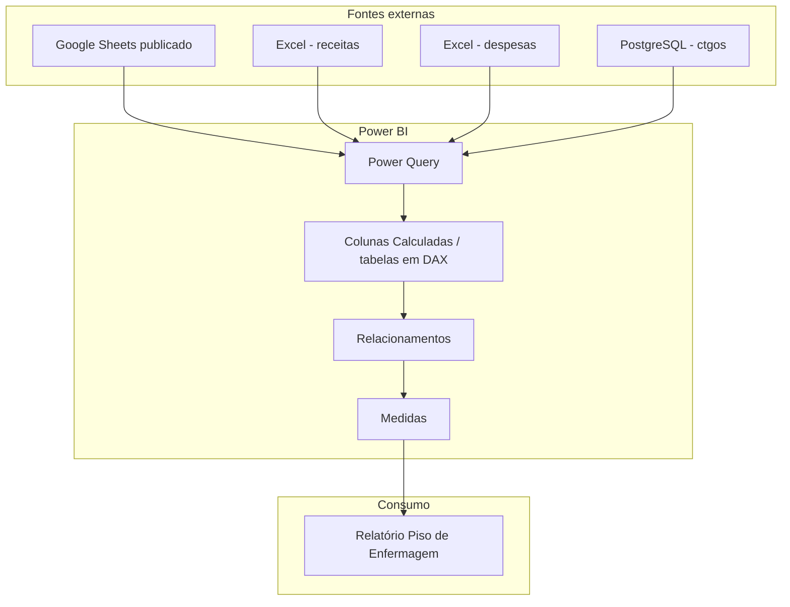

# Contexto do sistema

## Escopo

O artefato analisado é um projeto Power BI PBIP composto por **Report** e **SemanticModel**. Este repositório concentra a documentação do `SemanticModel`, porque é nele que estão conectividade, transformação, modelo relacional e medidas.

O relatório possui pelo menos duas páginas definidas no PBIP: `Pg Inicial` e `Página 1`. A documentação abaixo não tenta reconstruir intenção visual; trata o relatório como consumidor da camada semântica.

## Limite do escopo

## Responsabilidades implementadas no Power BI

| Responsabilidade | Implementação atual | Observação |
|---|---|---|
| extração | M / Power Query | quatro fontes heterogêneas |
| conversão de esquema | M / `Table.TransformColumnTypes` | forte dependência do esquema da origem |
| filtragem | M | ex.: receitas filtra `budgetAddCustTAValue <> 0` |
| padronização | M + DAX | nomes de OS e mês |
| surrogate/business key | DAX | concatenação de código + contrato |
| dados mestres | DAX | mapeamentos de OS e dimensões calculadas |
| calendário | DAX | `dim_data` + LocalDateTables automáticas |
| métrica | DAX | `Total Prestação de Contas` |

## Leitura de arquitetura

O desenho atual é um **modelo semântico com ETL embutido**. Não há evidência no projeto de uma camada de staging/bronze/silver externa ao Power BI para estas quatro fontes.

Esse ponto é importante: mudanças de origem, mappings e regras de qualidade exigem publicação do dataset, não apenas atualização de uma tabela upstream.
