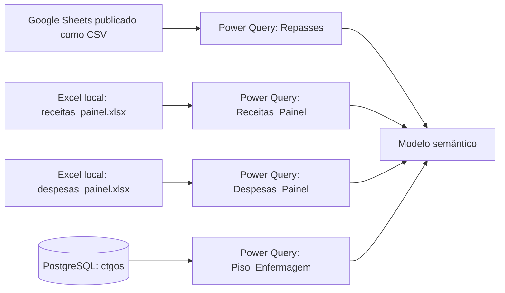

# Engenharia de dados

Esta pasta documenta como as fontes de dados chegam ao Power BI, quais consultas do Power Query são executadas, onde cada fonte é armazenada no modelo e quais dependências precisam estar disponíveis durante a atualização.

## Mapa da ingestão

## Documentos

- [Conexões e fluxo de ingestão](./conexoes_e_fluxo.md)
- [Relacionamentos do modelo](./relacionamentos_do_modelo.md)

## Escopo e limitações

As conexões foram documentadas a partir dos arquivos TMDL versionados neste repositório. Credenciais, gateway, agendamento, parâmetros do workspace e permissões dos sistemas de origem não estão armazenados aqui e precisam ser confirmados no Power BI Service ou no ambiente responsável por cada fonte.

O modelo usa modo **Import**: os dados são copiados durante a atualização do conjunto de dados e não são consultados em tempo real durante a navegação do relatório.
